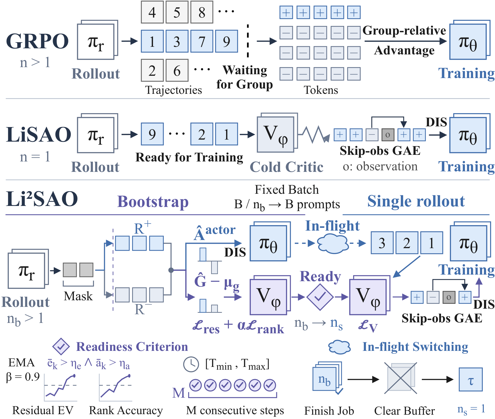

# Li2SAO

> The road ahead is long; yet RL shall seek high and low.

**Li2SAO (Lifting Light Single-Rollout Asynchronous RL Optimization via Group-Relative Actor-Critic Bootstrapping)** trains a single-rollout asynchronous policy without a pretrained value model. It first bootstraps the actor with group-relative advantages and the critic with group-centered returns. Once the critic is ready, training switches once to single-rollout GAE.

This repository trains Qwen3-4B on DAPO-Math-17K and evaluates on AIME 2024, AIME 2025, and AIME 2026. The two tasks are single-turn mathematical reasoning and ReTool agentic tool use. Each task compares GRPO, LiSAO, and Li2SAO on the same in-flight asynchronous pipeline.

This release covers those math experiments. The coding agentic RL experiments will be prepared and released separately.

## Method

<p align="center">
  
</p>

GRPO waits for a complete prompt group and assigns one group-relative advantage to every action token. LiSAO consumes each rollout on arrival, but a cold critic makes early GAE noisy. Li2SAO bootstraps the actor with group-relative advantages and the critic with centered returns, divergence masking, and terminal ranking, then switches to single-rollout GAE when residual explained variance and ranking accuracy exceed the thresholds.

Li2SAO addresses the cold critic without a separate value pretraining stage. During bootstrap it samples a small response group for each prompt and trains the actor and the critic together. The actor uses normalized group-relative advantages. The critic fits group-centered residual returns, so the target reflects which response succeeds. Shared prefixes are masked until responses diverge, and a terminal ranking loss orders the final values of mixed pairs.

Once that distinction is reliable, Li2SAO switches once to one rollout per prompt. The number of trajectories in each update stays fixed, and the number of prompts increases. After the switch, the actor uses skip-observation GAE and the critic fits absolute returns. Because generation overlaps training, the prefetched group job is finished and leftover bootstrap groups are discarded before the group size changes.

## Repository layout

Training code is in `lisao_slime`, a modified [slime](https://github.com/THUDM/slime) stack. Rollouts use SGLang and updates use Megatron.

| Path | Role |
| --- | --- |
| `lisao_slime/lisao/inflight_async` | Keep an unfinished prefix when a new policy is published and continue from it |
| `lisao_slime/lisao/sao` | LiSAO and Li2SAO |
| `examples/inflight_async` | GRPO training and single-turn AIME evaluation |
| `examples/lisao` | LiSAO and Li2SAO training |
| `examples/retool` | ReTool training and sandboxed evaluation |
| `scripts` | Environment setup, downloads, and checkpoint conversion |

LiSAO is a reproduction of SAO without its scaled value model. The critic starts from the same checkpoint as the policy. Attention stays frozen, and training updates the MLP blocks together with a scalar value head.

## Default settings

Shared choices:

| Setting | Value |
| --- | --- |
| Policy | Qwen3-4B, thinking off |
| Training set | DAPO-Math-17K |
| Context length | 32768 |
| Reward | binary outcome, plus a DAPO overlong penalty on the last quarter of the window |
| Rollout steps | 500 |
| Global batch size | 128 |
| Max policy lag | 16 |
| Optimizer | Adam, constant learning rate 1e-6, weight decay 0.1, betas 0.9 and 0.98 |
| Sampling | temperature 1.0, top-p 1.0 |
| Checkpoints | every 100 steps |
| Evaluation | offline, 16 samples per problem, temperature 1.0 |

GRPO uses 8 samples per prompt and the asymmetric clip 0.2 and 0.28. LiSAO uses 1 sample per prompt, length-adaptive GAE with alpha 1.5, DIS on the interval from 0.7 to 6.0, clip 0.3 and 5.0, critic learning rate 5e-6, 10 critic warmup steps, and 2 critic updates per batch.

Li2SAO uses the LiSAO clip, DIS interval, and critic, with no critic warmup. The bootstrap uses 8 samples per prompt, group-relative actor advantages, a group-centered critic target, value clip 0.2, and a ranking loss with coefficient 0.1 and margin 0.1. It switches once to single-rollout GAE when the smoothed residual explained variance is above 0.2 and the ranking accuracy is above 0.65 for 10 steps after step 60, or at step 150. Leftover bootstrap groups are dropped. The critic runs in the actor process.

ReTool starts from the tool-use supervised checkpoint `font-info/qwen3-4b-sft-SGLang-RL` and calls a Python interpreter. A trajectory has at most 16 turns, and each call times out after 120 seconds. GAE skips observation tokens. Evaluation uses the same sandbox.

The default machine layout is 8 GPUs, with 4 for training and 4 for rollout. Reference hardware: 8 NVIDIA A800 80GB GPUs.

## Setup

The scripts expect the official slime Docker image, with this repository mounted at `/root/LiSAO` and data at `/root/data`.

```bash
docker pull slimerl/slime:latest
docker run --gpus all --ipc=host --shm-size=64g \
  --ulimit memlock=-1 --ulimit stack=67108864 \
  -v /path/to/LiSAO:/root/LiSAO \
  -v /path/to/data:/root/data \
  -it slimerl/slime:latest /bin/bash

bash /root/LiSAO/scripts/setup_env.sh
```

Single-turn reasoning:

```bash
bash /root/LiSAO/scripts/download_assets.sh
bash /root/LiSAO/scripts/convert_qwen3_4b.sh
bash /root/LiSAO/examples/inflight_async/run-qwen3-4B-grpo.sh
bash /root/LiSAO/examples/lisao/run-qwen3-4B-lisao.sh
bash /root/LiSAO/examples/lisao/run-qwen3-4B-li2sao.sh
```

ReTool:

```bash
bash /root/LiSAO/examples/retool/download_assets.sh
bash /root/LiSAO/examples/retool/convert_qwen3_4b_sft.sh
bash /root/LiSAO/examples/retool/run-qwen3-4B-retool-grpo-inflight.sh
bash /root/LiSAO/examples/retool/run-qwen3-4B-retool-lisao-inflight.sh
bash /root/LiSAO/examples/retool/run-qwen3-4B-retool-li2sao-inflight.sh
```

Training does not evaluate. Score checkpoints afterward.

```bash
LOAD=/root/data/ckpts/qwen3-4B-li2sao \
  bash /root/LiSAO/examples/inflight_async/eval-qwen3-4B-aime-all.sh

LOAD=/root/data/ckpts/qwen3-4B-retool-li2sao-inflight \
  bash /root/LiSAO/examples/retool/eval-qwen3-4B-aime-all.sh
```

Single-turn evaluation is text only. ReTool evaluation uses the interpreter sandbox. Pass@k is the unbiased estimator from 16 samples at temperature 1.0.

Example READMEs under `examples/` give the task specific commands.
